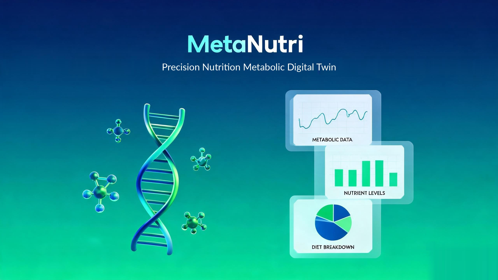
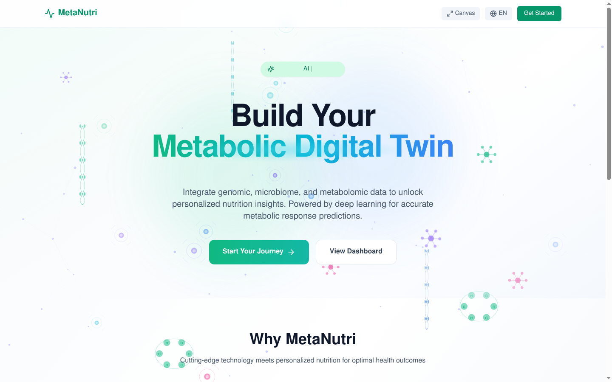
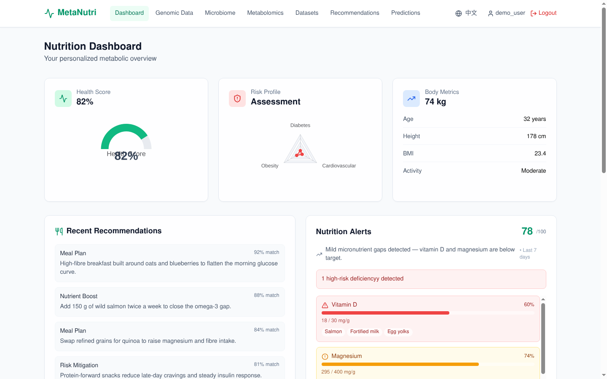
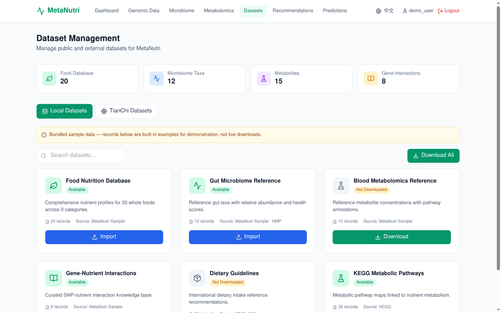
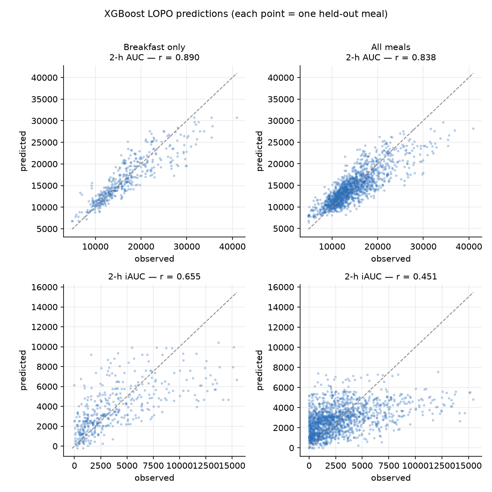
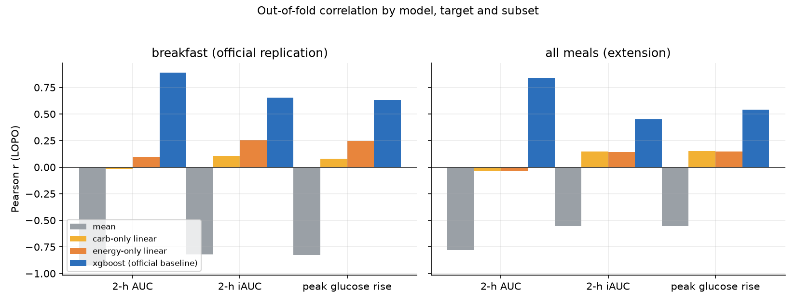
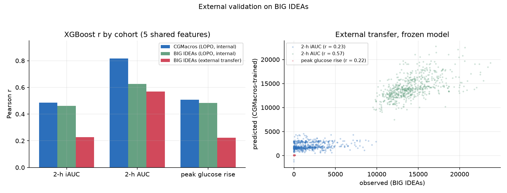
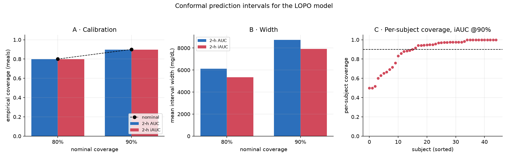

<div align="center">

<p align="right">
  <strong>English</strong> | <a href="README.zh-CN.md">简体中文</a>
</p>



# 🧬 MetaNutri

**Precision nutrition metabolic digital twin platform** — a production-style Next.js + FastAPI web app, a reproducible postprandial-glucose research module, and two published preprints.

[](https://doi.org/10.21203/rs.3.rs-11558064/v1)
[](https://github.com/ElijahZhao/MetaNutri---AI-/stargazers)
[](LICENSE)
[](https://github.com/ElijahZhao/MetaNutri---AI-/actions/workflows/ci.yml)
[](https://github.com/ElijahZhao/MetaNutri---AI-/tags)
[](https://github.com/ElijahZhao/MetaNutri---AI-/commits/main)

[](https://nextjs.org/)
[](https://fastapi.tiangolo.com/)
[](https://www.python.org/)
[](https://supabase.com/)
[](https://xgboost.readthedocs.io/)

[Live platform](https://meta-nutri-ai.vercel.app/) · [PPGR demo](https://metanutri-ai-ppgr-predictor.streamlit.app/) · [Nutri-RAG demo](https://metanutri-ai-rag-question-answering.streamlit.app/) · [Documentation](docs/) · [Report a bug](https://github.com/ElijahZhao/MetaNutri---AI-/issues)

**43 REST endpoints + `/health` · 8 curated datasets · 21-page technical report · full EN / 中文**

</div>

> **Positioning.** The deployed platform serves **deterministic, rule-based analytics**. The genuine machine learning lives in an independent, reproducible `research/` module and in two sibling repositories — it is not wired into the live API.

## ✨ Key highlights

- **Real machine learning on real open data.** [`research/`](research/) trains XGBoost on CGMacros (45 subjects) and evaluates strictly leave-one-subject-out: breakfast AUC *r* = 0.890 and iAUC *r* = 0.655, reproducing the published baseline. Code in [`research/src/`](research/src/), result CSVs in [`research/experiments/`](research/experiments/), a 21-page technical report in [`research/reports/`](research/reports/).
- **A full-stack platform, not a notebook.** Next.js 16 frontend, FastAPI backend and managed PostgreSQL, wired end to end: 43 business REST endpoints across 11 routers, httpOnly-cookie sessions, rate limiting, import/export, and ECharts dashboards.
- **Honest boundaries by construction.** Live glucose, nutrient-absorption and risk outputs are deterministic rules; `feature_contributions` is a transparent proportional decomposition, **not** SHAP; the PyTorch prototypes are never loaded at runtime.
- **Two published preprints (CC BY 4.0).** PPGR measurement reliability — [DOI `10.21203/rs.3.rs-11558064/v1`](https://doi.org/10.21203/rs.3.rs-11558064/v1) — and the NutriQA RAG benchmark — [DOI `10.21203/rs.3.rs-11565315/v1`](https://doi.org/10.21203/rs.3.rs-11565315/v1), both Research Square v1, 2 November 2026.
- **Reproducible and gated.** `bash research/src/run_all.sh` regenerates data, results, figures and the PDF; CI runs frontend typecheck/lint/Vitest/Playwright, backend pytest plus an import smoke test, and research ruff plus pytest under a 90% coverage gate.

## 📸 Preview

### Platform UI

| Landing page | Dashboard |
|:---:|:---:|
|  |  |

| Dataset management | Sign in |
|:---:|:---:|
|  |  |

Live: <https://meta-nutri-ai.vercel.app/>

### Research figures

Generated by the pipeline in [`research/src/make_figures.py`](research/src/make_figures.py) and shipped with the [technical report](research/reports/technical_report.pdf):

| Predictions vs actual | Model comparison |
|:---:|:---:|
|  |  |

| External validation (BIG IDEAs) | Conformal prediction intervals |
|:---:|:---:|
|  |  |

Live PPGR demo (runs the frozen model): <https://metanutri-ai-ppgr-predictor.streamlit.app/>

## 🚀 Quick start

**Prerequisites:** Python ≥ 3.11, Node.js ≥ 20, npm (or pnpm), and PostgreSQL 16 via Docker or a Supabase project.

```bash
# 1. Clone
git clone https://github.com/ElijahZhao/MetaNutri---AI-.git
cd MetaNutri---AI-

# 2. Backend
cd backend
cp .env.example .env          # fill in DATABASE_URL and SECRET_KEY
pip install -r requirements.txt
cd ..

# 3. Frontend
cd frontend
cp .env.example .env.local    # point NEXT_PUBLIC_API_URL at the backend
npm install
cd ..

# 4. Run (two terminals)
cd backend && uvicorn app.main:app --reload --host 0.0.0.0 --port 8000
cd frontend && npm run dev
```

| Service | URL |
|---|---|
| Frontend | <http://localhost:3000> |
| Backend API | <http://localhost:8000> |
| Swagger / ReDoc | <http://localhost:8000/docs> · <http://localhost:8000/redoc> |

**Docker (alternative):**

```bash
docker-compose up -d      # db + redis + backend + frontend
docker-compose logs -f
docker-compose down
```

**Research module** (independent dependencies, Python ≥ 3.12):

```bash
cd research
python -m venv .venv && source .venv/bin/activate
pip install -r requirements.txt
bash src/run_all.sh        # downloads CGMacros (~627 MB), builds the dataset, runs LOPO, writes experiments/ + reports/
```

The CGMacros dataset is ~627 MB and is never committed — see [`research/data/README.md`](research/data/README.md).

## 📁 Project structure

```
MetaNutri---AI-/
├── backend/                          # FastAPI backend
│   ├── app/
│   │   ├── api/                      # 11 routers: auth, users, food, genomic,
│   │   │                             #   microbiome, metabolomics, predict,
│   │   │                             #   recommendation, datasets, import_export, alerts
│   │   ├── core/                     # config, JWT + cookies, rate limit, Redis fallback
│   │   ├── db/session.py             # SQLAlchemy async engine
│   │   ├── ml/                       # deterministic explainer + local sample-data generator
│   │   ├── models/ schemas/          # ORM models and Pydantic schemas
│   │   ├── services/                 # seed data, import / export
│   │   └── main.py                   # FastAPI entry point
│   ├── data/                         # 8 curated reference datasets (JSON)
│   ├── tests/                        # pytest suite
│   ├── schema.sql                    # PostgreSQL DDL
│   ├── Dockerfile
│   └── requirements.txt
│
├── frontend/                         # Next.js 16 App Router
│   ├── src/app/                      # (auth) and (app) route groups, SEO, OG images
│   ├── src/components/               # landing, dashboard, charts, backgrounds
│   ├── src/lib/                      # api client, i18n, hooks, Zustand store
│   ├── src/proxy.ts                  # edge auth guard
│   ├── tests/e2e/                    # Playwright specs
│   └── package.json
│
├── research/                         # reproducible PPGR research module
│   ├── src/                          # download → build → LOPO → figures → PDF
│   ├── app/                          # Streamlit demo (frozen model)
│   ├── experiments/                  # result CSVs
│   ├── reports/                      # technical report (MD + 21-page PDF) and figures
│   ├── prototypes/                   # PyTorch prototypes (not wired to the API)
│   └── requirements.txt
│
├── docs/                             # API, architecture, datasets, deployment, roadmap
├── preprint/                         # published PPGR preprint PDF
├── .github/workflows/                # CI
├── docker-compose.yml
├── CHANGELOG.md · CITATION.cff · CONTRIBUTING.md · SECURITY.md
└── README.md
```

## 🛠️ Tech stack

### Frontend

| Technology | Version | Purpose |
|---|---|---|
| Next.js | 16 | App Router, SSR and SEO |
| React | 19 | UI components |
| TypeScript | 5 | Type safety |
| Tailwind CSS | 3 | Styling |
| ECharts | 6 | Dashboard charts |
| TanStack Query | 5 | Server state |
| Zustand | 5 | Client state |
| React Hook Form + Zod | 7 / 4 | Forms and validation |
| Custom i18n | — | EN / ZH translations in `src/lib/i18n.tsx` (no i18next dependency) |

### Backend

| Technology | Version | Purpose |
|---|---|---|
| FastAPI | 0.115.0 | Async REST API |
| Python | 3.11 | Runtime |
| SQLAlchemy | 2.0.31 | Async ORM |
| PostgreSQL | Supabase | Managed database |
| Pydantic | 2.8.2 | Validation |
| PyJWT | 2.15.1 | Tokens in httpOnly cookies |
| Passlib + bcrypt | 1.7.4 | Password hashing |
| Redis | 5.0.7 | Optional cache / rate limiting, in-memory fallback |

### Research

| Technology | Version | Purpose |
|---|---|---|
| XGBoost | 3.4.1 | Gradient-boosted PPGR model |
| scikit-learn | 1.9.1 | Baselines, metrics, preprocessing |
| SciPy / statsmodels | 1.18.1 / 0.15.0 | Statistics and mixed-effects model |
| NumPy / pandas | 2.5.3 / 3.0.6 | Data handling |
| Matplotlib | 3.11.2 | Report figures |
| Streamlit | 1.65.0 | Interactive demo |
| WeasyPrint | 70.0 | Technical-report PDF |
| PyTorch | not pinned | Prototype code only; never loaded at runtime |

## ❓ FAQ

<details>
<summary><strong>Is any of this a medical device?</strong></summary>

No. Everything here is for demonstration and portfolio purposes, and none of it is medical advice.
</details>

<details>
<summary><strong>Do the live API endpoints return trained-model predictions?</strong></summary>

No. Glucose, nutrient-absorption and risk outputs are deterministic rules. The `feature_contributions` field is a transparent proportional decomposition, not SHAP.
</details>

<details>
<summary><strong>Where is the real machine learning?</strong></summary>

In [`research/`](research/) — a reproducible PPGR pipeline trained on real open data and evaluated leave-one-subject-out, and in the two sibling repositories. See [Research details](#-research-details).
</details>

<details>
<summary><strong>Why are there three repositories?</strong></summary>

Different consumers, different runtimes. This repository is the source of truth; `MetaNutri-Ai-ppgr-predictor` is a one-way, regenerated Streamlit deployment of the research demo; `MetaNutri-Ai-RAG` is an independent research repository with its own paper. See [Repository relationships](#-repository-relationships).
</details>

<details>
<summary><strong>How do I reproduce the paper numbers?</strong></summary>

`cd research && bash src/run_all.sh` regenerates every CSV, figure and the PDF. The CGMacros download is ~627 MB and is not committed. Every number in this README comes from `research/experiments/*.csv`.
</details>

<details>
<summary><strong>Can I run it without PostgreSQL or Redis?</strong></summary>

Redis is optional (in-memory fallback). PostgreSQL is required for the platform; `docker-compose up -d` provisions it locally.
</details>

## 📝 Changelog

Full history: [`CHANGELOG.md`](CHANGELOG.md). Current release: **1.0.0** (2026-10-03).

| Version | Change |
|---|---|
| Unreleased | Ecosystem roles clarified in all READMEs; repository renames; two preprints added; Dependabot, ruff/test gates for `research/`; backend pytest suite |
| 1.0.0 | Platform, research module, documentation and CI consolidated for public release |

## 🔬 Research details

The module predicts the 2-hour postprandial glucose response (PPGR) on real open data, evaluated subject-wise so no person is ever in both train and test.

| Stage | Headline result |
|---|---|
| Reproduces the published baseline — CGMacros, breakfast, LOPO | AUC *r* = 0.890 · iAUC *r* = 0.655 (paper ≈ 0.89 / ≈ 0.64) |
| Extends across meal types — 1,557 of 1,699 meals, 45 subjects (142 non-positive-iAUC meals excluded) | AUC *r* = 0.838 · iAUC *r* = 0.451 |
| Transfers the frozen model to an independent cohort — BIG IDEAs, 16 subjects, 656 meals, Dexcom G6 | AUC *r* = 0.569; iAUC / peak *r* ≈ 0.22 → domain shift |
| Goes beyond a point estimate | Conformal intervals · within/between-subject decomposition · subject-random-intercept mixed-effects model |

- **Method:** strict leave-one-subject-out; XGBoost benchmarked against a mean predictor and two macronutrient-only Ridge baselines.
- **Artifacts:** [21-page report](research/reports/technical_report.pdf) · [pipeline](research/src/) · [result CSVs](research/experiments/) · [figures](research/reports/figures/).
- **Provenance:** every number is regenerated from `research/experiments/*.csv` and must match the technical report. The repository snapshot is pinned at tag [`v1.0.0`](https://github.com/ElijahZhao/MetaNutri---AI-/tree/v1.0.0).

## 🧩 Repository relationships

Three independent GitHub repositories. They are deliberately **not** linked by git — no submodule, no subtree.

| | This repository | [`MetaNutri-Ai-ppgr-predictor`](https://github.com/ElijahZhao/MetaNutri-Ai-ppgr-predictor) | [`MetaNutri-Ai-RAG`](https://github.com/ElijahZhao/MetaNutri-Ai-RAG) |
|---|---|---|---|
| **What it is** | Platform (`backend/`, `frontend/`) **and** research module (`research/`) | Streamlit deployment shell for the research demo | Independent RAG research repository with the 200-item NutriQA benchmark and its own preprint |
| **Live** | <https://meta-nutri-ai.vercel.app> | <https://metanutri-ai-ppgr-predictor.streamlit.app> | <https://metanutri-ai-rag-question-answering.streamlit.app> |
| **Role** | Source of truth | One-way, regenerated copy | Independent research repo |

**Flow is one way:** this repository → `MetaNutri-Ai-ppgr-predictor`. The demo holds a curated subset (`app.py`, `inference.py`, `model/*.json`, `assets/`, `src/`, `reports/`, `experiments/`) and imports nothing from the platform. If the two disagree, this repository wins. The RAG repository is not exported from here: it owns its data pipeline, retrieval stack, evaluation suite and paper.

## 🔌 API & AI/ML

The full endpoint list is in [`docs/API.md`](docs/API.md); interactive docs are at `/docs` and `/redoc`.

```http
POST /api/auth/login          # {username, password}
Set-Cookie: metanutri_access=...; HttpOnly; SameSite=Lax
Set-Cookie: metanutri_refresh=...; HttpOnly; SameSite=Lax
```

A complete call path: log in → upload omics (`/api/genomic/upload`, `/api/microbiome/upload`, `/api/metabolomics/upload`) → predict (`/api/predict/glucose-response`, `/api/predict/risk-assessment`) → recommendations (`/api/recommendations/meal-plan`) → read `feature_contributions` (heuristic weights, not SHAP).

| Module | Capability |
|---|---|
| `backend/app/ml/explainability.py` | Deterministic proportional explainer used by the live API |
| `research/prototypes/metabolic_response_model.py` | Glucose / nutrient prototype (not wired to the API) |
| `research/prototypes/gene_nutrition_model.py` | Gene–nutrition GNN prototype |
| `research/prototypes/microbiome_vae.py` | Microbiome VAE prototype |
| `research/prototypes/weights/` | Weights trained on synthetic tensors; never loaded at runtime |

## 🧪 Testing & CI

| Check | Tooling | Command |
|---|---|---|
| Typecheck | `tsc --noEmit` | `npm run typecheck` |
| Lint | ESLint flat config | `npm run lint` |
| Unit / component | Vitest + Testing Library | `npm test` |
| End-to-end | Playwright (Chromium) | `npm run test:e2e` |
| Backend | pytest + httpx | `python -m pytest -q` |
| Backend smoke | `compileall` + FastAPI import | `python -m compileall -q app` |
| Research | ruff + pytest, 90% coverage gate | `ruff check .` · `pytest` |

All jobs run on every push and pull request via [`.github/workflows/ci.yml`](.github/workflows/ci.yml).

## ☁️ Cloud deployment

| Component | Platform | Guide |
|---|---|---|
| Database | [Supabase](https://supabase.com/) | Run [`backend/schema.sql`](backend/schema.sql) in the SQL editor |
| Backend | [Render](https://render.com/) | Dockerfile path `backend/Dockerfile`; set `DATABASE_URL` (Supabase pooler, session mode, port 5432) and `SECRET_KEY` |
| Frontend | [Vercel](https://vercel.com/) | Root directory `frontend`; set `NEXT_PUBLIC_API_URL` |

## 🌟 About, status and scope

**MetaNutri** integrates genomics, microbiome and metabolomics data into personalized nutrition views.

- **What runs live:** authentication, database CRUD, food search, import/export, plus deterministic heuristics for glucose, nutrient-absorption and risk estimates — illustrative only.
- **Research scaffolding (not live):** `research/prototypes/` is not trained on real data and is never loaded at runtime.
- **Where the real AI is:** [`research/`](research/) and the two sibling repositories, deployed independently.
- **Not a medical device.** Nothing here is medical advice; never use it for clinical decisions.

| Problem | Response |
|---|---|
| Generic diet advice ignores individual biology | Recommendations keyed to a personal omics profile |
| Omics data is hard to interpret | Deterministic, guideline-based scoring |
| Health data is scattered | One dashboard for genomics, microbiome and metabolomics |
| "Black box" AI | Transparent rule-based scoring exposes contributing factors |
| Reactive healthcare | Early deficiency detection and risk alerts |

**Bundled datasets are curated samples, not third-party dumps.** The dataset "download" endpoints regenerate local sample files; the TianChi client returns mock placeholder listings. See [Limitations](docs/ROADMAP.md).

**Development note.** AI coding tools assisted with scaffolding, refactoring and documentation. Architecture, product decisions and final review are the author's own; generated output was reviewed and adapted before merging.

## 📚 Documentation

- [API.md](docs/API.md) — endpoints and auth
- [ARCHITECTURE.md](docs/ARCHITECTURE.md) — services, data flow, same-origin proxy
- [DATASETS.md](docs/DATASETS.md) — the 8 curated datasets and provenance
- [DEPLOYMENT.md](docs/DEPLOYMENT.md) — cloud deployment
- [ROADMAP.md](docs/ROADMAP.md) — research roadmap and scope
- [AUDITS.md](docs/AUDITS.md) — audit and remediation log
- [PROJECT-NOTES.md](docs/PROJECT-NOTES.md) — repository split rationale

## 🤝 Contributing

Bug reports, documentation fixes and code contributions are welcome.

1. Fork the repository
2. Create a branch (`git checkout -b feature/short-description`)
3. Commit (`git commit -m 'feat: describe your change'`)
4. Push (`git push origin feature/short-description`)
5. Open a pull request

See [CONTRIBUTING.md](CONTRIBUTING.md) for the full process.

## 📄 License

MIT — see [LICENSE](LICENSE). If you use this work, please cite it via [`CITATION.cff`](CITATION.cff).

## 📮 Contact

**ElijahZhao** — [@ElijahZhao](https://github.com/ElijahZhao) — yulinzhao04@gmail.com · 550568658@qq.com

Project: <https://github.com/ElijahZhao/MetaNutri---AI->
