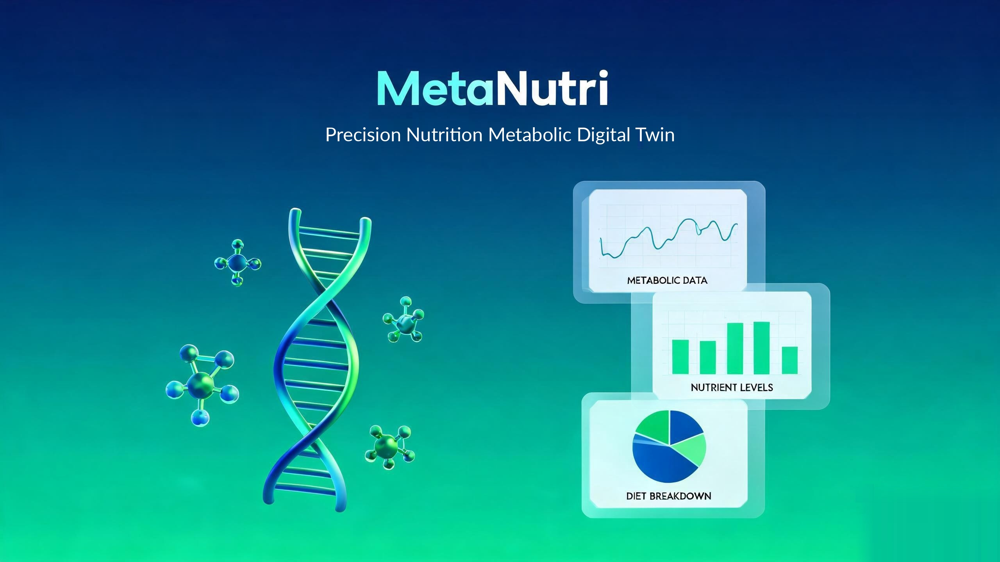
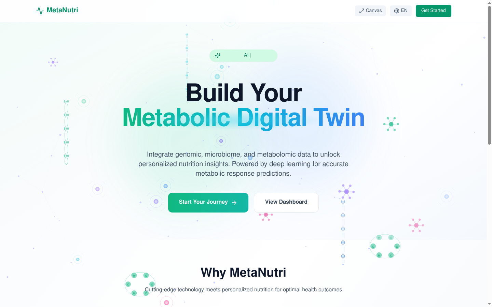
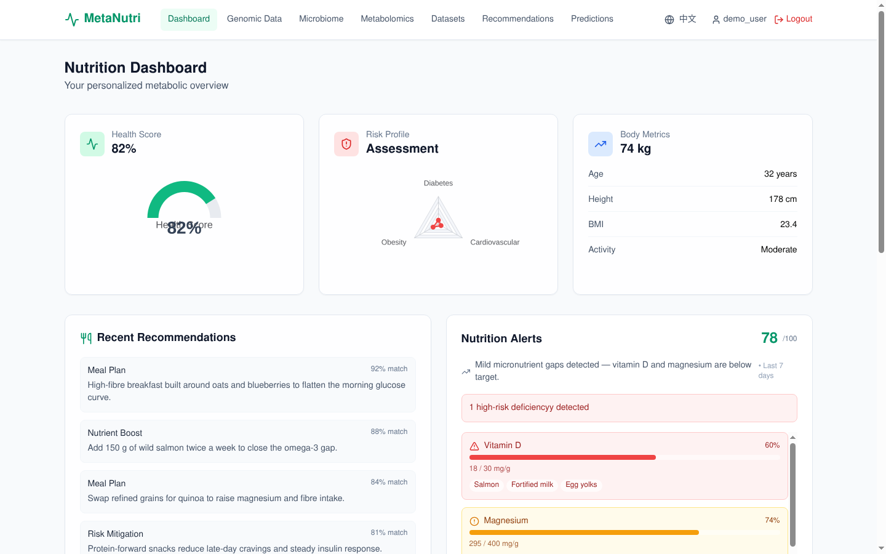
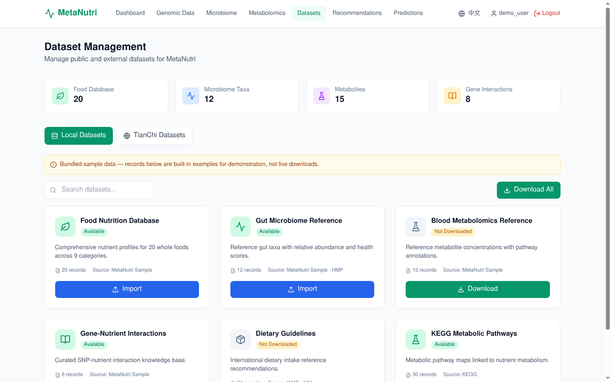
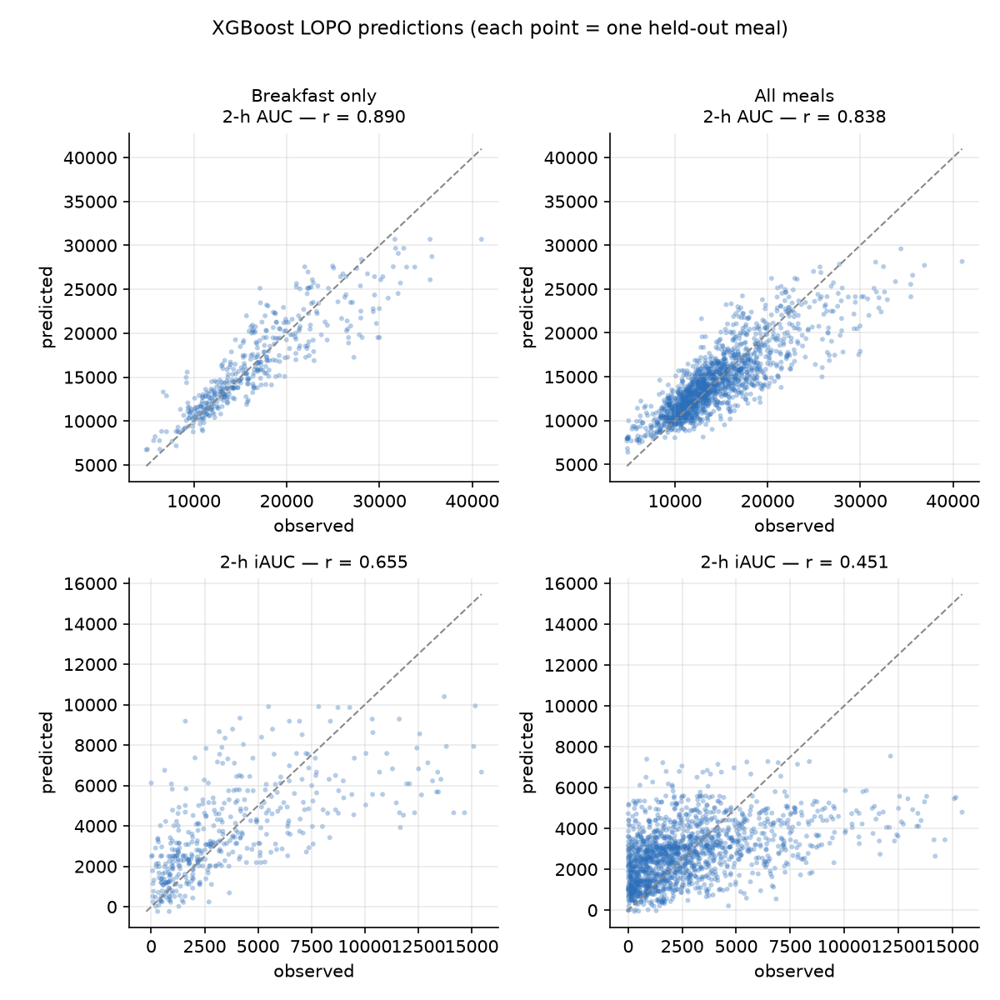
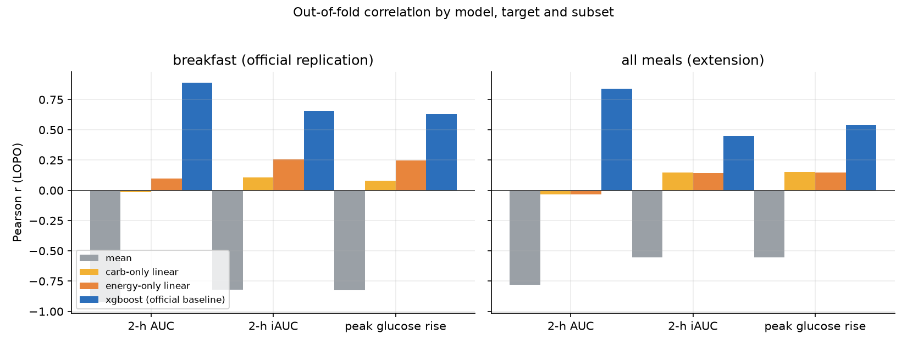
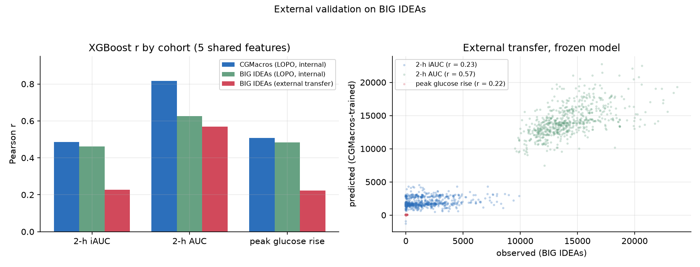
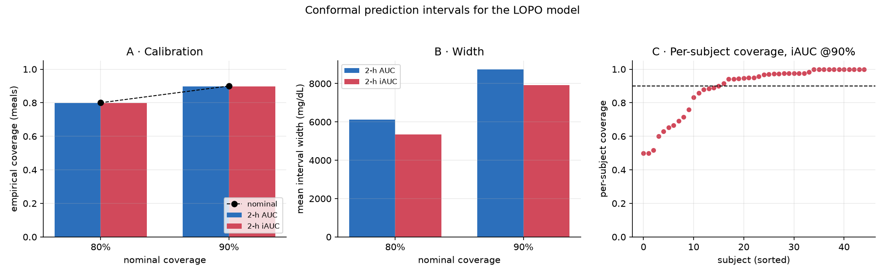

<div align="center">

<p align="right">
  <a href="README.md">English</a> | <strong>简体中文</strong>
</p>



# 🧬 MetaNutri

**精准营养代谢数字孪生平台** —— 一套生产级 Next.js + FastAPI 全栈应用、一个可复现的餐后血糖研究模块，以及两篇已发表的预印本。

[](https://doi.org/10.21203/rs.3.rs-11558064/v1)
[](https://github.com/ElijahZhao/MetaNutri---AI-/stargazers)
[](LICENSE)
[](https://github.com/ElijahZhao/MetaNutri---AI-/actions/workflows/ci.yml)
[](https://github.com/ElijahZhao/MetaNutri---AI-/tags)
[](https://github.com/ElijahZhao/MetaNutri---AI-/commits/main)

[](https://nextjs.org/)
[](https://fastapi.tiangolo.com/)
[](https://www.python.org/)
[](https://supabase.com/)
[](https://xgboost.readthedocs.io/)

[在线平台](https://meta-nutri-ai.vercel.app/) · [PPGR 演示](https://metanutri-ai-ppgr-predictor.streamlit.app/) · [Nutri-RAG 演示](https://metanutri-ai-rag-question-answering.streamlit.app/) · [文档](docs/) · [提交问题](https://github.com/ElijahZhao/MetaNutri---AI-/issues)

**43 个业务 REST 接口 + `/health` · 8 个精选数据集 · 21 页技术报告 · 中英双语**

</div>

> **定位。** 线上平台提供的是**确定性的规则分析**。真正的机器学习位于独立、可复现的 `research/` 模块与两个兄弟仓库中，并未接入线上 API。

## ✨ 核心亮点

- **基于真实开放数据的真实机器学习。** [`research/`](research/) 在 CGMacros（45 人）上训练 XGBoost，并严格按留一受试者（LOPO）评估：早餐 AUC *r* = 0.890、iAUC *r* = 0.655，复现了已发表的基线。代码在 [`research/src/`](research/src/)，结果 CSV 在 [`research/experiments/`](research/experiments/)，21 页技术报告在 [`research/reports/`](research/reports/)。
- **完整全栈工程，而非笔记本演示。** Next.js 16 前端、FastAPI 后端与托管 PostgreSQL 端到端串联：11 个路由模块、43 个业务 REST 接口、httpOnly Cookie 会话、限流、导入导出与 ECharts 仪表盘。
- **边界坦诚且可验证。** 线上的血糖、营养吸收与风险输出均为确定性规则；`feature_contributions` 是透明的比例分解，**不是** SHAP；PyTorch 原型在运行时从不加载。
- **两篇已发表预印本（CC BY 4.0）。** PPGR 测量可靠性——[DOI `10.21203/rs.3.rs-11558064/v1`](https://doi.org/10.21203/rs.3.rs-11558064/v1)；NutriQA RAG 基准——[DOI `10.21203/rs.3.rs-11565315/v1`](https://doi.org/10.21203/rs.3.rs-11565315/v1)。均为 Research Square v1，2026 年 11 月 2 日。
- **可复现且有门禁。** `bash research/src/run_all.sh` 重新生成数据、结果、图表与 PDF；CI 覆盖前端 typecheck/lint/Vitest/Playwright、后端 pytest 与导入冒烟测试、research ruff 与 90% 覆盖率门禁。

## 📸 效果预览

### 平台界面

| 落地页 | 仪表盘 |
|:---:|:---:|
|  |  |

| 数据集管理 | 登录 |
|:---:|:---:|
|  |  |

在线体验：<https://meta-nutri-ai.vercel.app/>

### 研究图表

由 [`research/src/make_figures.py`](research/src/make_figures.py) 生成，随[技术报告](research/reports/technical_report.pdf)发布：

| 预测值与实际值 | 模型对比 |
|:---:|:---:|
|  |  |

| 外部验证（BIG IDEAs） | 保形预测区间 |
|:---:|:---:|
|  |  |

PPGR 在线演示（运行冻结模型）：<https://metanutri-ai-ppgr-predictor.streamlit.app/>

## 🚀 快速开始

**前置条件：** Python ≥ 3.11、Node.js ≥ 20、npm（或 pnpm），以及 Docker 启动的 PostgreSQL 16 或一个 Supabase 项目。

```bash
# 1. 克隆
git clone https://github.com/ElijahZhao/MetaNutri---AI-.git
cd MetaNutri---AI-

# 2. 后端
cd backend
cp .env.example .env          # 填写 DATABASE_URL 与 SECRET_KEY
pip install -r requirements.txt
cd ..

# 3. 前端
cd frontend
cp .env.example .env.local    # 将 NEXT_PUBLIC_API_URL 指向后端
npm install
cd ..

# 4. 启动（两个终端）
cd backend && uvicorn app.main:app --reload --host 0.0.0.0 --port 8000
cd frontend && npm run dev
```

| 服务 | 地址 |
|---|---|
| 前端 | <http://localhost:3000> |
| 后端 API | <http://localhost:8000> |
| Swagger / ReDoc | <http://localhost:8000/docs> · <http://localhost:8000/redoc> |

**Docker（可选）：**

```bash
docker-compose up -d      # db + redis + backend + frontend
docker-compose logs -f
docker-compose down
```

**研究模块**（独立依赖，需 Python ≥ 3.12）：

```bash
cd research
python -m venv .venv && source .venv/bin/activate
pip install -r requirements.txt
bash src/run_all.sh        # 下载 CGMacros（约 627 MB）→ 构建数据集 → LOPO 评估 → 写出 experiments/ 与 reports/
```

CGMacros 数据集约 627 MB，**从不提交**——见 [`research/data/README.md`](research/data/README.md)。

## 📁 目录结构

```
MetaNutri---AI-/
├── backend/                          # FastAPI 后端
│   ├── app/
│   │   ├── api/                      # 11 个路由模块：auth、users、food、genomic、
│   │   │                             #   microbiome、metabolomics、predict、
│   │   │                             #   recommendation、datasets、import_export、alerts
│   │   ├── core/                     # 配置、JWT + Cookie、限流、Redis 回退
│   │   ├── db/session.py             # SQLAlchemy 异步引擎
│   │   ├── ml/                       # 确定性解释器 + 本地样例数据生成
│   │   ├── models/ schemas/          # ORM 模型与 Pydantic Schema
│   │   ├── services/                 # 种子数据、导入 / 导出
│   │   └── main.py                   # FastAPI 入口
│   ├── data/                         # 8 个精选参考数据集（JSON）
│   ├── tests/                        # pytest 测试
│   ├── schema.sql                    # PostgreSQL 建表语句
│   ├── Dockerfile
│   └── requirements.txt
│
├── frontend/                         # Next.js 16 App Router
│   ├── src/app/                      # (auth) 与 (app) 路由组、SEO、OG 图
│   ├── src/components/               # 落地页、仪表盘、图表、背景组件
│   ├── src/lib/                      # API 客户端、i18n、hooks、Zustand store
│   ├── src/proxy.ts                  # 边缘鉴权守卫
│   ├── tests/e2e/                    # Playwright 用例
│   └── package.json
│
├── research/                         # 可复现的 PPGR 研究模块
│   ├── src/                          # 下载 → 构建 → LOPO → 图表 → PDF
│   ├── app/                          # Streamlit 演示（冻结模型）
│   ├── experiments/                  # 结果 CSV
│   ├── reports/                      # 技术报告（MD + 21 页 PDF）与图表
│   ├── prototypes/                   # PyTorch 原型（未接入 API）
│   └── requirements.txt
│
├── docs/                             # API、架构、数据集、部署、路线图
├── preprint/                         # 已发表的 PPGR 预印本 PDF
├── .github/workflows/                # CI
├── docker-compose.yml
├── CHANGELOG.md · CITATION.cff · CONTRIBUTING.md · SECURITY.md
└── README.md
```

## 🛠️ 技术栈

### 前端

| 技术 | 版本 | 用途 |
|---|---|---|
| Next.js | 16 | App Router、SSR 与 SEO |
| React | 19 | UI 组件 |
| TypeScript | 5 | 类型安全 |
| Tailwind CSS | 3 | 样式 |
| ECharts | 6 | 仪表盘图表 |
| TanStack Query | 5 | 服务端状态 |
| Zustand | 5 | 客户端状态 |
| React Hook Form + Zod | 7 / 4 | 表单与校验 |
| 自研 i18n | — | `src/lib/i18n.tsx` 中的中英翻译（无 i18next 依赖） |

### 后端

| 技术 | 版本 | 用途 |
|---|---|---|
| FastAPI | 0.115.0 | 异步 REST API |
| Python | 3.11 | 运行时 |
| SQLAlchemy | 2.0.31 | 异步 ORM |
| PostgreSQL | Supabase | 托管数据库 |
| Pydantic | 2.8.2 | 数据校验 |
| PyJWT | 2.15.1 | httpOnly Cookie 中的令牌 |
| Passlib + bcrypt | 1.7.4 | 密码哈希 |
| Redis | 5.0.7 | 可选缓存 / 限流，内存回退 |

### 研究

| 技术 | 版本 | 用途 |
|---|---|---|
| XGBoost | 3.4.1 | 梯度提升 PPGR 模型 |
| scikit-learn | 1.9.1 | 基线、指标、预处理 |
| SciPy / statsmodels | 1.18.1 / 0.15.0 | 统计与混合效应模型 |
| NumPy / pandas | 2.5.3 / 3.0.6 | 数据处理 |
| Matplotlib | 3.11.2 | 报告图表 |
| Streamlit | 1.65.0 | 交互式演示 |
| WeasyPrint | 70.0 | 技术报告 PDF |
| PyTorch | 未锁定 | 仅原型代码，运行时从不加载 |

## ❓ 常见问题

<details>
<summary><strong>这是医疗器械吗？</strong></summary>

不是。本项目仅用于演示与作品集展示，任何内容都不构成医疗建议。
</details>

<details>
<summary><strong>线上 API 返回的是训练模型的预测吗？</strong></summary>

不是。血糖、营养吸收与风险输出均为确定性规则。`feature_contributions` 是透明的比例分解，不是 SHAP。
</details>

<details>
<summary><strong>真正的机器学习在哪里？</strong></summary>

在 [`research/`](research/)——基于真实开放数据、按留一受试者评估的可复现 PPGR 管线；以及两个兄弟仓库。见[研究细节](#-研究细节)。
</details>

<details>
<summary><strong>为什么有三个仓库？</strong></summary>

面向不同消费者与运行时。本仓库是事实来源；`MetaNutri-Ai-ppgr-predictor` 是单向再生成的 Streamlit 部署壳；`MetaNutri-Ai-RAG` 是拥有独立论文的独立研究仓库。见[仓库关系](#-仓库关系)。
</details>

<details>
<summary><strong>如何复现论文数字？</strong></summary>

`cd research && bash src/run_all.sh` 会重新生成全部 CSV、图表与 PDF。CGMacros 下载约 627 MB，且不提交进仓库。本 README 中所有数字均来自 `research/experiments/*.csv`。
</details>

<details>
<summary><strong>可以不用 PostgreSQL 或 Redis 吗？</strong></summary>

Redis 可选（内存回退）。平台需要 PostgreSQL；本地可用 `docker-compose up -d` 启动。
</details>

## 📝 更新日志

完整历史：[`CHANGELOG.md`](CHANGELOG.md)。当前版本：**1.0.0**（2026-10-03）。

| 版本 | 变更 |
|---|---|
| Unreleased | 各 README 明确三仓角色；仓库更名；新增两篇预印本；Dependabot；`research/` 的 ruff 与测试门禁；后端 pytest 套件 |
| 1.0.0 | 平台、研究模块、文档与 CI 面向公开发布完成整合 |

## 🔬 研究细节

该模块在真实开放数据上预测餐后 2 小时血糖反应（PPGR），按受试者划分，确保同一个人不会同时出现在训练集与测试集。

| 阶段 | 主要结果 |
|---|---|
| 复现已发表基线——CGMacros，早餐，LOPO | AUC *r* = 0.890 · iAUC *r* = 0.655（论文约 0.89 / 0.64） |
| 扩展到全部餐型——1,699 餐中的 1,557 餐，45 人（剔除 142 个 iAUC 非正样本） | AUC *r* = 0.838 · iAUC *r* = 0.451 |
| 冻结模型迁移到独立队列——BIG IDEAs，16 人，656 餐，Dexcom G6 | AUC *r* = 0.569；iAUC / 峰值 *r* ≈ 0.22 → 域偏移 |
| 超越点估计 | 保形区间 · 组内/组间分解 · 受试者随机截距混合效应模型 |

- **方法：** 严格留一受试者；XGBoost 与均值预测器、两个仅宏量营养素的 Ridge 基线对比。
- **产物：** [21 页报告](research/reports/technical_report.pdf) · [复现管线](research/src/) · [结果 CSV](research/experiments/) · [图表](research/reports/figures/)。
- **溯源：** 所有数字由 `research/experiments/*.csv` 重新生成，且必须与技术报告一致。仓库快照固定在标签 [`v1.0.0`](https://github.com/ElijahZhao/MetaNutri---AI-/tree/v1.0.0)。

## 🧩 仓库关系

三个独立的 GitHub 仓库，刻意**不**通过 git 关联——没有 submodule，也没有 subtree。

| | 本仓库 | [`MetaNutri-Ai-ppgr-predictor`](https://github.com/ElijahZhao/MetaNutri-Ai-ppgr-predictor) | [`MetaNutri-Ai-RAG`](https://github.com/ElijahZhao/MetaNutri-Ai-RAG) |
|---|---|---|---|
| **是什么** | 平台（`backend/`、`frontend/`）**与研究模块**（`research/`） | 研究演示的 Streamlit 部署壳 | 独立 RAG 研究仓库，拥有 200 题 NutriQA 基准与自己的预印本 |
| **在线** | <https://meta-nutri-ai.vercel.app> | <https://metanutri-ai-ppgr-predictor.streamlit.app> | <https://metanutri-ai-rag-question-answering.streamlit.app> |
| **角色** | 事实来源 | 单向再生成副本 | 独立研究仓库 |

**数据流是单向的：** 本仓库 → `MetaNutri-Ai-ppgr-predictor`。演示仓只保留精选子集（`app.py`、`inference.py`、`model/*.json`、`assets/`、`src/`、`reports/`、`experiments/`），不从平台导入任何代码。若两者不一致，以本仓库为准。RAG 仓库并非从本仓库导出：它拥有自己的数据管线、检索栈、评测套件与论文。

## 🔌 API 与 AI/ML

完整接口列表见 [`docs/API.md`](docs/API.md)；交互式文档在 `/docs` 与 `/redoc`。

```http
POST /api/auth/login          # {username, password}
Set-Cookie: metanutri_access=...; HttpOnly; SameSite=Lax
Set-Cookie: metanutri_refresh=...; HttpOnly; SameSite=Lax
```

完整调用链：登录 → 上传组学数据（`/api/genomic/upload`、`/api/microbiome/upload`、`/api/metabolomics/upload`）→ 预测（`/api/predict/glucose-response`、`/api/predict/risk-assessment`）→ 建议（`/api/recommendations/meal-plan`）→ 读取 `feature_contributions`（启发式权重，不是 SHAP）。

| 模块 | 能力 |
|---|---|
| `backend/app/ml/explainability.py` | 线上 API 使用的确定性比例解释器 |
| `research/prototypes/metabolic_response_model.py` | 血糖 / 营养原型（未接入 API） |
| `research/prototypes/gene_nutrition_model.py` | 基因–营养 GNN 原型 |
| `research/prototypes/microbiome_vae.py` | 微生物组 VAE 原型 |
| `research/prototypes/weights/` | 合成张量训练的权重；运行时从不加载 |

## 🧪 测试与 CI

| 检查 | 工具 | 命令 |
|---|---|---|
| 类型检查 | `tsc --noEmit` | `npm run typecheck` |
| Lint | ESLint flat config | `npm run lint` |
| 单元 / 组件 | Vitest + Testing Library | `npm test` |
| 端到端 | Playwright（Chromium） | `npm run test:e2e` |
| 后端 | pytest + httpx | `python -m pytest -q` |
| 后端冒烟 | `compileall` + FastAPI 导入 | `python -m compileall -q app` |
| 研究 | ruff + pytest，90% 覆盖率门禁 | `ruff check .` · `pytest` |

所有任务均由 [`.github/workflows/ci.yml`](.github/workflows/ci.yml) 在每次 push 与 pull request 时执行。

## ☁️ 云端部署

| 组件 | 平台 | 要点 |
|---|---|---|
| 数据库 | [Supabase](https://supabase.com/) | 在 SQL Editor 运行 [`backend/schema.sql`](backend/schema.sql) |
| 后端 | [Render](https://render.com/) | Dockerfile 路径 `backend/Dockerfile`；设置 `DATABASE_URL`（Supabase pooler，session 模式，端口 5432）与 `SECRET_KEY` |
| 前端 | [Vercel](https://vercel.com/) | Root Directory 设为 `frontend`；设置 `NEXT_PUBLIC_API_URL` |

## 🌟 项目定位、状态与边界

**MetaNutri** 将基因组、微生物组与代谢组数据整合为个性化营养视图。

- **线上运行的内容：** 认证、数据库 CRUD、食物搜索、导入导出，以及血糖、营养吸收与风险的确定性启发式估算——仅作示意。
- **研究脚手架（不在线上）：** `research/prototypes/` 未在真实数据上训练，运行时从不加载。
- **真实 AI 所在：** [`research/`](research/) 与两个兄弟仓库，独立部署。
- **不是医疗器械。** 这里没有任何医疗建议；切勿用于临床决策。

| 问题 | 应对 |
|---|---|
| 通用饮食建议忽视个体生物学差异 | 依据个人组学档案给出建议 |
| 组学数据难以解读 | 确定性、基于指南的打分 |
| 健康数据分散 | 基因组、微生物组、代谢组统一仪表盘 |
| "黑箱" AI | 透明的规则打分暴露贡献因素 |
| 被动医疗 | 早期营养缺乏检测与风险提醒 |

**内置数据集是精选样例，并非第三方数据转储。** "下载"接口只是重新生成本地样例文件；天池客户端返回模拟占位清单。详见[研究路线与边界](docs/ROADMAP.md)。

**开发说明。** AI 编程工具在脚手架、重构与文档方面提供了辅助。架构、产品决策与最终审查均由作者完成；生成内容经复核与改写后才合并。

## 📚 文档

- [API.md](docs/API.md)——接口与认证
- [ARCHITECTURE.md](docs/ARCHITECTURE.md)——服务、数据流与同源代理
- [DATASETS.md](docs/DATASETS.md)——8 个精选数据集与来源
- [DEPLOYMENT.md](docs/DEPLOYMENT.md)——云端部署
- [ROADMAP.md](docs/ROADMAP.md)——研究路线与边界
- [AUDITS.md](docs/AUDITS.md)——审查与修复记录
- [PROJECT-NOTES.md](docs/PROJECT-NOTES.md)——仓库拆分理由

## 🤝 参与贡献

欢迎提交问题、文档修正与代码贡献。

1. Fork 本仓库
2. 创建分支（`git checkout -b feature/short-description`）
3. 提交（`git commit -m 'feat: describe your change'`）
4. 推送（`git push origin feature/short-description`）
5. 发起 Pull Request

完整流程见 [CONTRIBUTING.md](CONTRIBUTING.md)。

## 📄 许可证

MIT——见 [LICENSE](LICENSE)。如使用本项目，请通过 [`CITATION.cff`](CITATION.cff) 引用。

## 📮 联系方式

**ElijahZhao** —— [@ElijahZhao](https://github.com/ElijahZhao) —— yulinzhao04@gmail.com · 550568658@qq.com

项目地址：<https://github.com/ElijahZhao/MetaNutri---AI->
