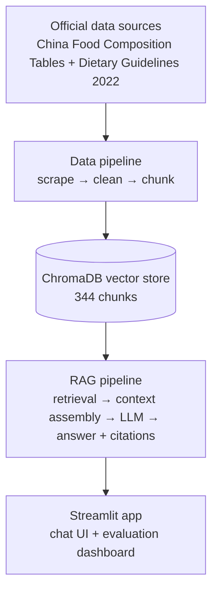

<div align="center">

<p align="right">
  <strong>English</strong> | <a href="README.zh-CN.md">简体中文</a>
</p>

# 🥗 Nutri-RAG

**Health-diet question answering via retrieval-augmented generation (RAG)** — an independent research repository in the MetaNutri ecosystem.

[](https://doi.org/10.21203/rs.3.rs-11565315/v1)
[](https://metanutri-ai-rag-question-answering.streamlit.app/)
[](https://github.com/ElijahZhao/MetaNutri-Ai-RAG/actions/workflows/ci-gates.yml)
[](LICENSE)
[](https://www.python.org/)

**325 foods × 32 nutrients · 19 guideline sections · 344 knowledge chunks · NutriQA 200-item benchmark**

</div>

**Nutri-RAG** answers health-diet questions grounded in official Chinese nutrition data: the *China Food Composition Tables* (325 foods × 32 nutrients) and the *Dietary Guidelines for Chinese Residents (2022)* (8 principles plus detailed practice sections) — **344 knowledge chunks** in total. It is also where the **NutriQA** benchmark (200 traceable questions across three commercial models) was built.

## ✨ Highlights

- **Balanced two-path retrieval.** Food chunks and guideline chunks are retrieved separately with equal quota, so guideline recommendations are never crowded out by the 325 food chunks.
- **Citation-grounded answers.** Every key claim carries a `[n]` reference to its source chunk, making the answer traceable and checkable.
- **A real benchmark, not a demo.** The NutriQA 200-item set (composition 60 / guideline 50 / special 50 / refusal 40) supports no-RAG vs RAG ablation across three models and regenerates with one command.
- **Reproducible data pipeline.** Official sources → scrape → clean → chunk → vector store, all scripted and versioned.
- **Lightweight deployment.** A single-process Streamlit app on the free tier; the vector store is restored from a committed tarball when missing.

## 📸 Preview

| Chat · Chinese — every answer carries `[n]` citations | Chat · English — answers follow the UI language |
|---|---|
|  |  |

| Evaluation page · Chinese UI — 160-item metrics and per-item coverage | Evaluation page · English UI |
|---|---|
|  |  |

Live demo: <https://metanutri-ai-rag-question-answering.streamlit.app/>

### Paper figures (NutriQA)

Regenerated with [`docs/figures/make_figures.py`](docs/figures/make_figures.py) from `data/eval_report*.json` / `data/refusal_report*.json`:

| Fig 1 · Evaluation pipeline | Fig 2 · RQ1 retrieval ablation |
|---|---|
|  |  |

| Fig 3 · RQ2 faithfulness by category | Fig 4 · RQ3 refusal under three protocols |
|---|---|
|  |  |

| Fig 5 · RQ4 judgment agreement | Fig 6 · RQ5 boundary hallucination |
|---|---|
|  |  |

## 🚀 Quick start

```bash
git clone https://github.com/ElijahZhao/MetaNutri-Ai-RAG.git
cd MetaNutri-Ai-RAG
pip install -r requirements.txt

# Put your Alibaba Bailian key in .env:
#   DASHSCOPE_API_KEY=sk-...

# Optional: rebuild the vector store (auto-restored from data/chroma_db.tar.gz if missing)
python3 src/kb.py --rebuild

streamlit run app.py
```

On Streamlit Community Cloud, set `DASHSCOPE_API_KEY` under **Advanced settings → Secrets** (TOML), as shown in `.streamlit/secrets.toml.example`.

## 📁 Project structure

```
├── app.py                  # Streamlit demo: chat + citations + evaluation dashboard
├── src/
│   ├── config.py           # pipeline configuration
│   ├── retrieval.py        # balanced two-path retrieval (food + guideline)
│   ├── hybrid.py           # BM25 char-bigram + vector RRF fusion
│   ├── generation.py       # context assembly + LLM answer with [n] citations
│   ├── kb.py               # ChromaDB build / rebuild
│   ├── evaluation.py       # 160-item generation eval + no-RAG vs RAG ablation
│   ├── eval_refusal.py     # 40-item refusal evaluation
│   ├── eval_sweep.py       # hyper-parameter sweep (9 runs)
│   └── eval_hybrid.py      # hybrid vs vector comparison
├── data/
│   ├── fetch_*.py          # official-source collection scripts
│   ├── build_kb_texts.py   # chunking: 325 food + 19 guideline chunks
│   ├── build_eval_set.py   # benchmark generation
│   ├── eval_questions.json # 160-item generation set
│   ├── kb_foods.txt        # 325 food chunks
│   ├── kb_guidelines.txt   # 19 guideline chunks
│   ├── chroma_db.tar.gz    # vector store backup (344 chunks)
│   └── SOURCES.md          # provenance registry
├── docs/                   # paper, figures, benchmark spec, error analysis
└── requirements.txt
```

## 🛠️ Tech stack

| Component | Choice |
|---|---|
| Language | Python 3.12 |
| Demo UI | Streamlit |
| Vector store | ChromaDB (embedded, file-based) |
| Embedding | `text-embedding-v3` (Alibaba DashScope) |
| LLM | `qwen-plus` (OpenAI-compatible endpoint) |
| Retrieval | BM25 char-bigram + vector, RRF fusion, `top_k=8` |
| Evaluation | NutriQA 200 items (160 generation + 40 refusal), three models |

## ❓ FAQ

<details>
<summary><strong>Why not a full-stack app?</strong></summary>

The research contribution here is the retrieval pipeline, citation grounding and evaluation. Full-stack engineering is demonstrated by the sibling MetaNutri platform.
</details>

<details>
<summary><strong>Where does the data come from?</strong></summary>

Official public sources only: the China Food Composition Tables (China CDC) and the 2022 Dietary Guidelines (Chinese Nutrition Society). Every processing step is scripted — see [`data/SOURCES.md`](data/SOURCES.md).
</details>

<details>
<summary><strong>What does it cost to run?</strong></summary>

Near zero: all heavy computation is on the API side, and the free Streamlit tier is sufficient.
</details>

<details>
<summary><strong>How do I reproduce the tables?</strong></summary>

`git checkout v1.0.1` pins the paper, data, code and figures. Then run `python3 src/evaluation.py`, `python3 src/eval_refusal.py`, `python3 src/eval_sweep.py` and `python3 src/eval_hybrid.py`.
</details>

## 📝 Changelog

- **v0.7** — Publication: NutriQA preprint on Research Square (DOI `10.21203/rs.3.rs-11565315/v1`, CC BY 4.0); PDF added under `docs/paper/`; `CITATION.cff` added; tag `v1.0.1` pins data, code, evidence, figures and paper files.
- **v0.6** — Portfolio and robustness: narrative guide, EN/ZH evaluation screenshots, publication memo, readable API-failure handling.
- **v0.5** — UI and i18n: full English interface, streaming answers, warm theme, evaluation panel, 8 English example questions.
- **v0.4** — Research suite: refusal evaluation, 9-run sweep, hybrid comparison, failure attribution.
- **v0.3** — Streamlit demo (chat + citations + evaluation dashboard), deployed.
- **v0.2** — RAG pipeline: balanced two-path retrieval, citation generation, 50-case eval + ablation.
- **v0.1** — Data pipeline: 325 foods × 32 nutrients, 17 guideline chunks, 342-chunk vector store.

## 📄 Preprint

> **NutriQA: A Traceable RAG Question-Answering Benchmark and Empirical Study on Official Chinese Nutrition Data**
>
> Yulin Zhao · *Research Square* · v1 · 2 November 2026 · **CC BY 4.0**
>
> **DOI** [`10.21203/rs.3.rs-11565315/v1`](https://doi.org/10.21203/rs.3.rs-11565315/v1) · **PDF** [published version in this repository](docs/paper/NutriQA-paper-researchsquare-v1.pdf)

The 200-item benchmark, evaluation scripts, figures and manuscripts all live here — [`docs/paper/`](docs/paper/) · [`docs/figures/`](docs/figures/) · [English source](docs/paper/NutriQA-paper.md) · [中文稿](docs/paper/NutriQA-paper-zh.md).

## 🏗️ Architecture



## 📊 Evaluation

**Current benchmark (NutriQA v1.0.0 baseline)** — 200 items (composition 60 / guideline 50 / special 50 / refusal 40), hybrid retrieval (BM25 char-bigram + vector RRF, `top_k=8`), KB = 344 chunks (325 foods + 19 guideline sections), three commercial models. All numbers are regenerated from `data/eval_report*.json` / `data/refusal_report*.json`.

### Generation evaluation (160 items)

| Metric | qwen-plus | deepseek-chat | glm-5.3-flash |
|---|---|---|---|
| Retrieval hit rate | 1.0 | 1.0 | 1.0 |
| Faithfulness | 0.9625 | **0.9938** | 0.9875 |
| Gold cover (RAG → NoRAG) | 0.9625 → 0.7625 | 0.9938 → 0.7688 | 0.9875 → 0.7625 |
| RAG gain | 0.20 | 0.225 | 0.225 |

### Refusal evaluation (40 items)

| Protocol | qwen-plus | deepseek-chat | glm-5.3-flash |
|---|---|---|---|
| RAG (with retrieved context) | 1.0 | 1.0 | 0.975 |
| NoRAG (bare LLM) | 0.0 | 0.0 | 0.025 |
| Strict (refuse instruction) | 0.675 | 0.925 | 0.925 |

**Boundary hallucination (10 out-of-KB numeric-bait items):** bare LLMs fabricate numeric values **100%** of the time across all three models; RAG refusal suppresses this to ~0–2.5%.

**Automated-judgment gate (stratified 40-item sample, 39 valid):** deterministic rules–human **0.949**, LLM-judge–human 0.846, rules–LLM-judge 0.850.

### Historical 50-case baseline

<details>
<summary>Superseded by the v1.0.0 benchmark — retained for the research record</summary>

Offline evaluation on 50 hand-verified cases (20 composition / 15 guideline / 15 special; gold answers are real CSV values or verbatim guideline text), qwen-plus, 100 LLM calls:

| Metric | Score |
|---|---|
| Retrieval hit rate | 100% (50/50) |
| Generation faithfulness | 100% (50/50) |
| Citation rate | 100% (50/50) |
| Gold-info coverage, no-RAG → RAG | 88% → 100% |

Refusal evaluation: 10 out-of-scope questions — RAG 100% (10/10), bare LLM 0% (0/10), bare LLM with a "refuse" instruction 80% (8/10).

Hyper-parameter sweep: 9 configurations (`top_k` ∈ {3, 5, 8} × threshold ∈ {0.2, 0.35, 0.5}); `top_k=5` with no threshold was the best setting on this subset, while the v1.0.0 benchmark uses hybrid retrieval at `top_k=8`.

Hybrid vs vector on 50 cases: both reach 100% retrieval hit; hybrid shows 96% citation and faithfulness. No retrieval gain on this saturated subset, so vector-only was the default at the time.

</details>

## 📚 Data sources

- **China Food Composition Tables** — National Institute for Nutrition and Health, China CDC (<https://nlc.chinanutri.cn/fq/>)
- **Dietary Guidelines for Chinese Residents (2022)** — Chinese Nutrition Society (<http://dg.cnsoc.org/>)

Full provenance, scraping scripts and rebuild instructions: [`data/SOURCES.md`](data/SOURCES.md).

## 🔗 Ecosystem

- **MetaNutri** — full-stack precision-nutrition platform ([repo](https://github.com/ElijahZhao/MetaNutri---AI-) · [demo](https://meta-nutri-ai.vercel.app/))
- **MetaNutri-Ai-ppgr-predictor** — 2-hour postprandial glucose prediction ([repo](https://github.com/ElijahZhao/MetaNutri-Ai-ppgr-predictor) · [demo](https://metanutri-ai-ppgr-predictor.streamlit.app/))
- **Nutri-RAG** (this repository) — health-diet Q&A via RAG and the research home of NutriQA ([preprint](https://doi.org/10.21203/rs.3.rs-11565315/v1))

## 📌 Citation

> Zhao, Y. (2026). *NutriQA: A Traceable RAG Question-Answering Benchmark and Empirical Study on Official Chinese Nutrition Data*. Research Square. DOI: [10.21203/rs.3.rs-11565315/v1](https://doi.org/10.21203/rs.3.rs-11565315/v1) · CC BY 4.0

Machine-readable: [`CITATION.cff`](CITATION.cff). Reproduce with `git checkout v1.0.1` — data, code, evidence, figures and paper files are pinned at that tag.

## ⚠️ Disclaimer

Research and educational demonstration only. Not medical advice. For health concerns, consult a licensed physician or registered dietitian.

## 📄 License

Code and data in this repository are [MIT](LICENSE); the preprint and its figures are CC BY 4.0 — consistent with the MetaNutri ecosystem.
