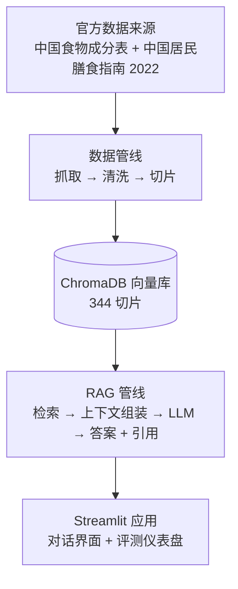

<div align="center">

<p align="right">
  <a href="README.md">English</a> | <strong>简体中文</strong>
</p>

# 🥗 Nutri-RAG

**基于检索增强生成（RAG）的健康饮食问答** —— MetaNutri 生态中的独立研究仓库。

[](https://doi.org/10.21203/rs.3.rs-11565315/v1)
[](https://metanutri-ai-rag-question-answering.streamlit.app/)
[](https://github.com/ElijahZhao/MetaNutri-Ai-RAG/actions/workflows/ci-gates.yml)
[](LICENSE)
[](https://www.python.org/)

**325 种食物 × 32 项营养 · 19 段指南 · 344 个知识切片 · NutriQA 200 题基准**

</div>

**Nutri-RAG** 基于中国官方营养数据回答健康饮食问题：*《中国食物成分表》*（325 种食物 × 32 项营养）与 *《中国居民膳食指南（2022）》*（8 条准则 + 准则六详细实践）——共 **344 个知识切片**。这里也是 **NutriQA** 基准（200 道可溯源题目、三个商用模型）的诞生地。

## ✨ 核心亮点

- **双路均衡检索。** 食物切片与指南切片分路检索、配额相等，指南建议不会被 325 个食物切片挤掉。
- **引用可溯源。** 每个关键结论都带 `[n]` 引用，指向来源切片，答案可逐条核查。
- **真基准，而非演示。** NutriQA 200 题（成分 60 / 指南 50 / 特殊 50 / 拒答 40），支持三个模型的 no-RAG vs RAG 消融，一条命令即可重新生成。
- **可复现的数据管线。** 官方来源 → 抓取 → 清洗 → 切片 → 向量库，全流程脚本化并纳入版本控制。
- **轻量部署。** 单进程 Streamlit 应用可跑在免费层；向量库缺失时从仓库内压缩包自动恢复。

## 📸 效果预览

| 对话 · 中文——每个答案都带 `[n]` 引用 | 对话 · 英文——答案跟随界面语言 |
|---|---|
|  |  |

| 评测页 · 中文界面——160 题指标与逐题覆盖 | 评测页 · 英文界面 |
|---|---|
|  |  |

在线演示：<https://metanutri-ai-rag-question-answering.streamlit.app/>

### 论文图表（NutriQA）

由 [`docs/figures/make_figures.py`](docs/figures/make_figures.py) 从 `data/eval_report*.json` / `data/refusal_report*.json` 生成：

| 图 1 · 评测流程 | 图 2 · RQ1 检索消融 |
|---|---|
|  |  |

| 图 3 · RQ2 分类忠实度 | 图 4 · RQ3 三种协议下的拒答 |
|---|---|
|  |  |

| 图 5 · RQ4 判定一致性 | 图 6 · RQ5 边界幻觉 |
|---|---|
|  |  |

## 🚀 快速开始

```bash
git clone https://github.com/ElijahZhao/MetaNutri-Ai-RAG.git
cd MetaNutri-Ai-RAG
pip install -r requirements.txt

# 在 .env 中配置阿里云百炼 API Key：
#   DASHSCOPE_API_KEY=sk-...

# 可选：重建向量库（缺失时会自动从 data/chroma_db.tar.gz 恢复）
python3 src/kb.py --rebuild

streamlit run app.py
```

在 Streamlit Community Cloud 上，于 **Advanced settings → Secrets**（TOML 格式）设置 `DASHSCOPE_API_KEY`，示例见 `.streamlit/secrets.toml.example`。

## 📁 目录结构

```
├── app.py                  # Streamlit 演示：对话 + 引用 + 评测仪表盘
├── src/
│   ├── config.py           # 管线配置
│   ├── retrieval.py        # 双路均衡检索（食物 + 指南）
│   ├── hybrid.py           # BM25 字符 bigram + 向量 RRF 融合
│   ├── generation.py       # 上下文组装 + 带 [n] 引用的 LLM 回答
│   ├── kb.py               # ChromaDB 构建 / 重建
│   ├── evaluation.py       # 160 题生成评测 + no-RAG vs RAG 消融
│   ├── eval_refusal.py     # 40 题拒答评测
│   ├── eval_sweep.py       # 超参数扫描（9 组）
│   └── eval_hybrid.py      # 混合检索 vs 向量检索对比
├── data/
│   ├── fetch_*.py          # 官方来源采集脚本
│   ├── build_kb_texts.py   # 切片：325 食物 + 19 指南
│   ├── build_eval_set.py   # 基准生成
│   ├── eval_questions.json # 160 题生成评测集
│   ├── kb_foods.txt        # 325 个食物切片
│   ├── kb_guidelines.txt   # 19 个指南切片
│   ├── chroma_db.tar.gz    # 向量库备份（344 切片）
│   └── SOURCES.md          # 来源登记
├── docs/                   # 论文、图表、基准规范、错误分析
└── requirements.txt
```

## 🛠️ 技术栈

| 组件 | 选型 |
|---|---|
| 语言 | Python 3.12 |
| 演示界面 | Streamlit |
| 向量库 | ChromaDB（嵌入式、文件存储） |
| 向量模型 | `text-embedding-v3`（阿里云百炼） |
| 大模型 | `qwen-plus`（OpenAI 兼容端点） |
| 检索 | BM25 字符 bigram + 向量，RRF 融合，`top_k=8` |
| 评测 | NutriQA 200 题（160 生成 + 40 拒答），三个模型 |

## ❓ 常见问题

<details>
<summary><strong>为什么不做成全栈应用？</strong></summary>

本仓库的研究贡献在检索管线、引用溯源与评测。全栈工程能力由兄弟项目 MetaNutri 平台展示。
</details>

<details>
<summary><strong>数据来自哪里？</strong></summary>

仅使用官方公开来源：中国疾控中心《中国食物成分表》与中国营养学会《中国居民膳食指南（2022）》。每一步处理都已脚本化——见 [`data/SOURCES.md`](data/SOURCES.md)。
</details>

<details>
<summary><strong>运行成本高吗？</strong></summary>

接近零：重计算都在 API 侧，免费的 Streamlit 层足够。
</details>

<details>
<summary><strong>如何复现表格？</strong></summary>

`git checkout v1.0.1` 固定论文、数据、代码与图表。随后运行 `python3 src/evaluation.py`、`python3 src/eval_refusal.py`、`python3 src/eval_sweep.py` 与 `python3 src/eval_hybrid.py`。
</details>

## 📝 更新日志

- **v0.7** —— 发表：NutriQA 预印本上线 Research Square（DOI `10.21203/rs.3.rs-11565315/v1`，CC BY 4.0）；`docs/paper/` 加入正式版 PDF；新增 `CITATION.cff`；标签 `v1.0.1` 固定数据、代码、证据、图表与论文文件。
- **v0.6** —— 作品集与健壮性：叙事指南、中英评测截图、发表机会备忘、可读的 API 失败处理。
- **v0.5** —— 界面与国际化：完整英文界面、流式回答、暖色主题、评测面板、8 道英文示例题。
- **v0.4** —— 研究套件：拒答评测、9 组超参数扫描、混合检索对比、失败归因。
- **v0.3** —— Streamlit 演示（对话 + 引用 + 评测仪表盘），已部署。
- **v0.2** —— RAG 管线：双路均衡检索、带引用生成、50 题评测与消融。
- **v0.1** —— 数据管线：325 食物 × 32 营养、17 段指南、342 切片向量库。

## 📄 预印本

> **NutriQA: A Traceable RAG Question-Answering Benchmark and Empirical Study on Official Chinese Nutrition Data**
>
> Yulin Zhao · *Research Square* · v1 · 2026 年 11 月 2 日 · **CC BY 4.0**
>
> **DOI** [`10.21203/rs.3.rs-11565315/v1`](https://doi.org/10.21203/rs.3.rs-11565315/v1) · **PDF** [仓库内正式版](docs/paper/NutriQA-paper-researchsquare-v1.pdf)

200 题基准、评测脚本、图表与稿件都在本仓库——[`docs/paper/`](docs/paper/) · [`docs/figures/`](docs/figures/) · [英文源稿](docs/paper/NutriQA-paper.md) · [中文稿](docs/paper/NutriQA-paper-zh.md)。

## 🏗️ 架构



## 📊 评测结果

**当前基准（NutriQA v1.0.0 基线）** —— 200 题（成分 60 / 指南 50 / 特殊 50 / 拒答 40），混合检索（BM25 字符 bigram + 向量 RRF，`top_k=8`），知识库 344 切片（325 食物 + 19 指南），三个商用模型。所有数字由 `data/eval_report*.json` / `data/refusal_report*.json` 重新生成。

### 生成评测（160 题）

| 指标 | qwen-plus | deepseek-chat | glm-5.3-flash |
|---|---|---|---|
| 检索命中率 | 1.0 | 1.0 | 1.0 |
| 忠实度 | 0.9625 | **0.9938** | 0.9875 |
| 金标覆盖（RAG → NoRAG） | 0.9625 → 0.7625 | 0.9938 → 0.7688 | 0.9875 → 0.7625 |
| RAG 增益 | 0.20 | 0.225 | 0.225 |

### 拒答评测（40 题）

| 协议 | qwen-plus | deepseek-chat | glm-5.3-flash |
|---|---|---|---|
| RAG（带检索上下文） | 1.0 | 1.0 | 0.975 |
| NoRAG（裸模型） | 0.0 | 0.0 | 0.025 |
| Strict（拒答指令） | 0.675 | 0.925 | 0.925 |

**边界幻觉（10 道知识库外、数字诱饵题）：** 裸模型在三个模型上 **100%** 编造数字；RAG 拒答将其压到约 0–2.5%。

**自动判定门禁（分层 40 题样本，39 题有效）：** 确定性规则–人工 **0.949**，LLM 裁判–人工 0.846，规则–LLM 裁判 0.850。

### 历史 50 题基线

<details>
<summary>已被 v1.0.0 基准取代——保留作为研究记录</summary>

50 道人工核验题（20 成分 / 15 指南 / 15 特殊；金标答案均为真实 CSV 数值或指南原文），qwen-plus，共 100 次 LLM 调用：

| 指标 | 分数 |
|---|---|
| 检索命中率 | 100%（50/50） |
| 生成忠实度 | 100%（50/50） |
| 引用率 | 100%（50/50） |
| 金标信息覆盖，no-RAG → RAG | 88% → 100% |

拒答评测：10 道范围外问题——RAG 100%（10/10），裸模型 0%（0/10），带"拒答"指令的裸模型 80%（8/10）。

超参数扫描：9 组配置（`top_k` ∈ {3, 5, 8} × 阈值 ∈ {0.2, 0.35, 0.5}）；该子集上 `top_k=5` 且不设阈值最佳，而 v1.0.0 基准使用 `top_k=8` 的混合检索。

混合 vs 向量（50 题）：两者检索命中率均为 100%；混合检索的引用率与忠实度为 96%。该子集已饱和、无检索增益，故当时默认向量检索。

</details>

## 📚 数据来源

- **中国食物成分表** —— 中国疾病预防控制中心营养与健康所（<https://nlc.chinanutri.cn/fq/>）
- **中国居民膳食指南（2022）** —— 中国营养学会（<http://dg.cnsoc.org/>）

完整来源、抓取脚本与重建说明：[`data/SOURCES.md`](data/SOURCES.md)。

## 🔗 生态关联

- **MetaNutri** —— 全栈精准营养平台（[仓库](https://github.com/ElijahZhao/MetaNutri---AI-) · [演示](https://meta-nutri-ai.vercel.app/)）
- **MetaNutri-Ai-ppgr-predictor** —— 餐后 2 小时血糖预测（[仓库](https://github.com/ElijahZhao/MetaNutri-Ai-ppgr-predictor) · [演示](https://metanutri-ai-ppgr-predictor.streamlit.app/)）
- **Nutri-RAG**（本仓库）—— 基于 RAG 的健康饮食问答，NutriQA 论文的研究主场（[预印本](https://doi.org/10.21203/rs.3.rs-11565315/v1)）

## 📌 引用方式

> Zhao, Y. (2026). *NutriQA: A Traceable RAG Question-Answering Benchmark and Empirical Study on Official Chinese Nutrition Data*. Research Square. DOI: [10.21203/rs.3.rs-11565315/v1](https://doi.org/10.21203/rs.3.rs-11565315/v1) · CC BY 4.0

机器可读：[`CITATION.cff`](CITATION.cff)。复现请 `git checkout v1.0.1`——数据、代码、证据、图表与论文文件均固定在该标签。

## ⚠️ 免责声明

仅用于研究与教学演示，不构成医疗建议。如有健康问题，请咨询执业医师或注册营养师。

## 📄 开源协议

本仓库代码与数据为 [MIT](LICENSE)；预印本及其图表为 CC BY 4.0——与 MetaNutri 生态保持一致。
